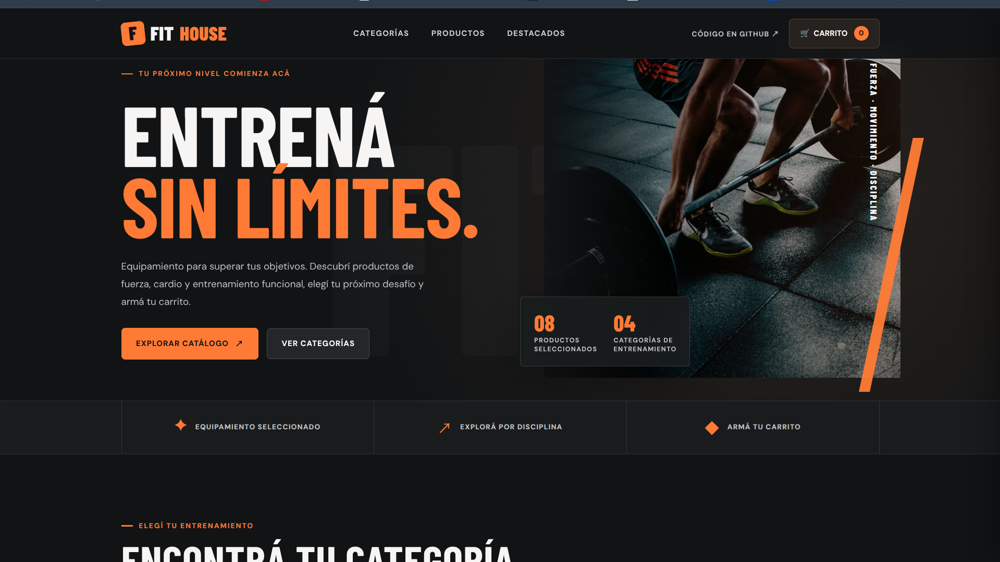

# FitHouse | Fitness E-commerce

A responsive fitness equipment storefront built with **Node.js, Express, EJS and JavaScript**. It combines a searchable catalog, product details, session-based shopping cart and local account management. The application was originally developed collaboratively and later reorganized and extended for this portfolio repository.

**[Explore the live storefront](https://ericpino87.github.io/fithouse-marketplace-portfolio/)** · **[View architecture and case study](docs/CASE_STUDY_ES.md)**



## Features

- Responsive product catalog with keyword and category filters.
- Product detail pages and shopping cart with totals.
- Local user registration and sign-in using hashed passwords.
- Product administration in the locally hosted Express application.
- Automated catalog and cart tests with GitHub Actions.

## Technology

| Layer | Technology |
|---|---|
| Server | Node.js 20+, Express |
| Views | EJS, HTML, CSS |
| Interactions | JavaScript |
| Authentication | Express sessions, bcryptjs |
| Storage | Local JSON files |
| Quality | Node test runner, GitHub Actions |

## Run locally

Install **Node.js 20+**, then run:

```bash
npm install
npm start
```

Open **http://localhost:3500**. To check the code:

```bash
npm test
npm run check
```

## Live website vs. local application

The [public website](https://ericpino87.github.io/fithouse-marketplace-portfolio/) runs the browser-based storefront from `docs/index.html` with an illustrative product catalog, search, category filtering and cart interactions.

The **Express / EJS application** in `src/` runs separately on a local Node.js server and adds login, sessions and local catalog administration. GitHub Pages cannot host that Node.js backend.

**Scope:** Prices and inventory are illustrative. The website does not process orders, payments or shipments. The local application stores accounts and products in JSON for development purposes and is **not configured for production use**. Do not use actual customer records or passwords.

## Repository layout

```text
.github/workflows/   Continuous integration
 data/                Product catalog seed
 docs/index.html      Public web storefront (GitHub Pages)
 public/css/          Express application styles
 src/app.js           Express application routes
 src/lib/             Catalog and persistence logic
 src/views/           EJS templates
 tests/               Automated tests
```

## Collaborative development and attribution

The original FitHouse project was developed collaboratively by:

- Pablo Domañski
- Ángel Mauricio Cerutti de la Cruz
- Eric Pino Najarro
- Carolina Ruiz
- Cristian Giraldo Londoño
- Andrés López

Original team repository: [Pdomans/grupo_13_TBA](https://github.com/Pdomans/grupo_13_TBA).

This repository also contains subsequent refactoring, replacement of sample content, automated tests, and the web storefront intended for GitHub Pages. These later changes should not be attributed to the original team unless independently verified. The listing of contributors acknowledges collaboration and does not assert equal contributions.

## Security notes

The local application uses a randomly generated session secret by default. Before deploying it to a server, configure a persistent strong `SESSION_SECRET`, HTTPS, a production session store, a database, input protection and rate limiting. Local runtime data files are excluded from Git via `.gitignore`.

---

[Ver descripción del proyecto en español](docs/CASE_STUDY_ES.md)
