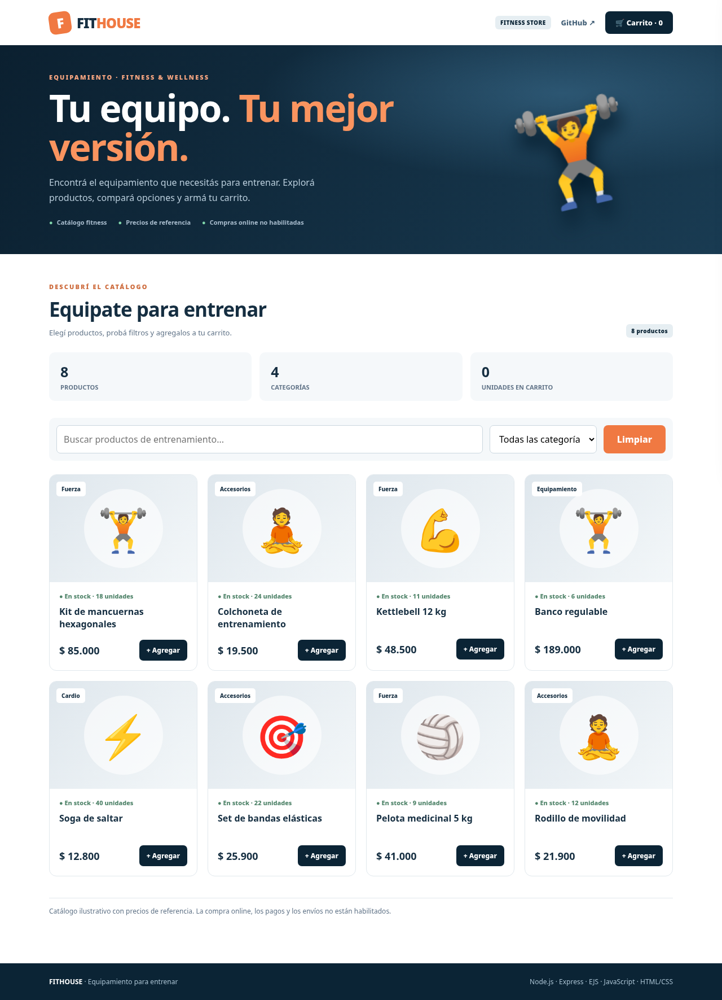

# FitHouse — Fitness E-commerce | Full Stack Portfolio

> **Educational group project, restored for portfolio.** This is a modernized, demonstrative reconstruction based on the original FitHouse e-commerce coursework. It uses **fictional products and prices**. No purchases, payment processing or real inventory take place.

[**🚀 Interactive live demo — GitHub Pages**](https://ericpino87.github.io/fithouse-marketplace-portfolio/) *(works after this repository is published with GitHub Pages enabled from `/docs`)*



## Business challenge

Design a simple digital storefront for home and gym fitness equipment. Visitors should be able to discover products and simulate a purchase journey; registered demo users can manage the catalog locally.

## Features

| Feature | Express / EJS full-stack app | GitHub Pages demo |
|---|---:|---:|
| Responsive storefront | ✅ | ✅ |
| Product catalog & text/category search | ✅ | ✅ |
| Product details | ✅ | Product cards |
| Add/remove items & calculate cart total | ✅ Server session | ✅ Browser session |
| Register/login | ✅ Local demo with bcrypt | — |
| Add/delete products | ✅ Local demo after login | — |
| Payments and shipping | ❌ Not implemented | ❌ Not implemented |
| Production database | ❌ JSON demo storage | ❌ |

**Important distinction:** GitHub Pages runs the *standalone static demonstration* in `docs/index.html`. It **does not run the Node.js/Express backend**. For the full app, follow the steps below.

## Stack

- **Backend:** Node.js 20+, Express, EJS, express-session, bcryptjs
- **Frontend:** HTML, CSS, JavaScript; responsive product cards
- **Data:** local JSON mock data, automatically initialized from `data/products.sample.json`
- **Quality checks:** Node's built-in test runner, GitHub Actions

## Run the full-stack app locally

Prerequisites: **Node.js 20+** and Internet access for the first dependency install.

```bash
npm install
npm start
```

Open **http://localhost:3500**. You can also use `npm run dev` for development.

For a local demo, no secret configuration is required: a random session secret is generated per startup. Before hosting in a real environment, configure a long, random `SESSION_SECRET`, HTTPS, persistent session storage, rate limiting, a real data store, and additional application security controls.

To reset data generated by demo users, stop the server and delete the two ignored local files: `data/users.json` and `data/products.json`.

## Run automated checks

```bash
npm test
npm run check
```

These tests check **catalog behavior, filtering, validation, cart calculations and file syntax**. They do not replace HTTP integration testing or a real production security review.

## Publish the interactive demo

1. Create a GitHub repository named `fithouse-marketplace-portfolio`.
2. Upload the contents of this package, preserving its folders.
3. Open **Settings → Pages**.
4. Select **Deploy from a branch** → `main` → **`/docs`** → **Save**.
5. Open `https://YOUR-USERNAME.github.io/fithouse-marketplace-portfolio/`.

GitHub Pages hosts only the HTML/CSS/JS demo. **Do not enable `/(root)`** for this project: the static entry point is `docs/index.html`.

## Structure

```text
├── .github/workflows/checks.yml  # Automated source checks
├── data/products.sample.json     # Fictional stock data
├── docs/index.html               # One-file interactive GitHub Pages demo
├── public/css/main.css           # Full-stack storefront styles
├── src/app.js                     # Express application and routes
├── src/lib/catalog.js            # Search, validation, cart calculations
├── src/lib/store.js              # Local JSON demo store
├── src/views/                   # EJS pages and reusable partials
└── tests/catalog.test.js         # Node tests
```

## Original team and attribution

The original **FitHouse** group coursework was credited to:

- Pablo Domañski
- Ángel Mauricio Cerutti de la Cruz
- Eric Pino Najarro
- Carolina Ruiz
- Cristian Giraldo Londoño
- Andrés López

Source reference: [`Pdomans/grupo_13_TBA`](https://github.com/Pdomans/grupo_13_TBA) (historical academic group repository).

This portfolio edition is **a reconstruction and refactoring**, not the untouched source code of the original team. It is presented as **group coursework**, not as an individual claim of authorship for all original work. Confirm team/course permissions before distributing any original assets or code not included here.

## What changed in the portfolio edition?

- Repaired the broken Node.js entrypoint and consolidated routes.
- Replaced the original user databases with an **empty local user store** and fictional product catalog.
- Removed hardcoded session secrets, demo user photos and unused/unfinished downloads.
- Added working local sign-up/sign-in, session cart, product management for demo accounts, validation and CSRF tokens.
- Rebuilt the storefront as a responsive, accessible demonstration without copying product photographs.
- Added a separate GitHub Pages demo, tests and documentation.

These improvements were made **after the original course project**; they should not be confused with features implemented by the original group at that time.

## Security and limitations

This project is for **local learning / portfolio demonstrations only**. It is not production-ready: authentication is backed by local JSON, sessions use Express MemoryStore, there is no transactional inventory, and there is no payment gateway or checkout. The static demo never asks for passwords, and its cart is stored only in the visitor's browser session.

**Do not enter real credentials or customer information.** Local runtime files `data/users.json` and `data/products.json` are excluded by `.gitignore`.

---

[Versión en español / Case study](docs/CASE_STUDY_ES.md)
